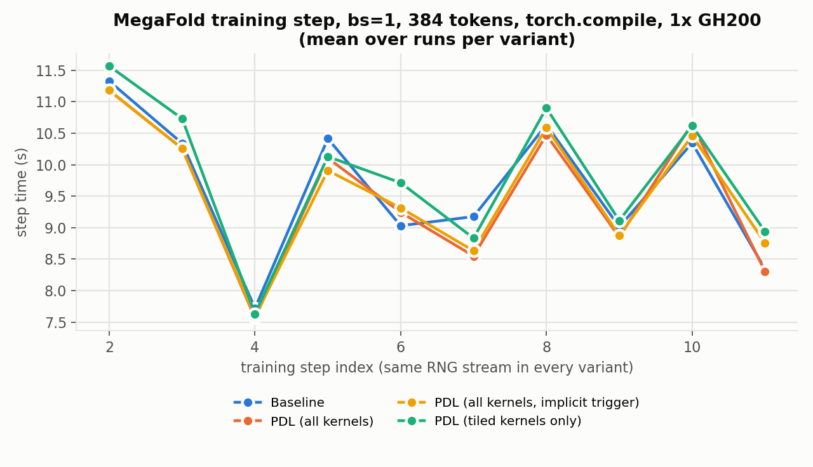
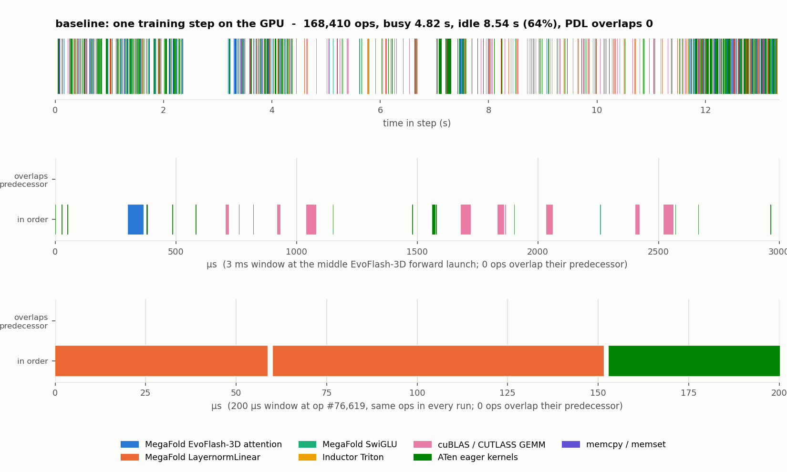
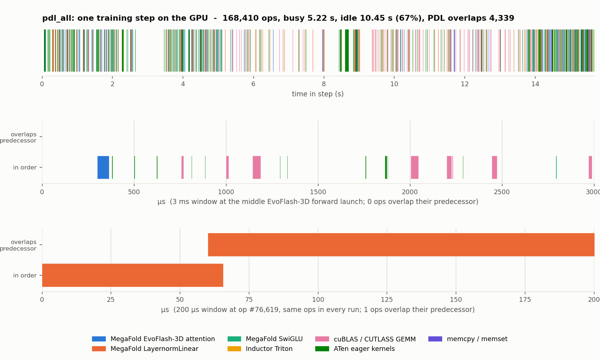
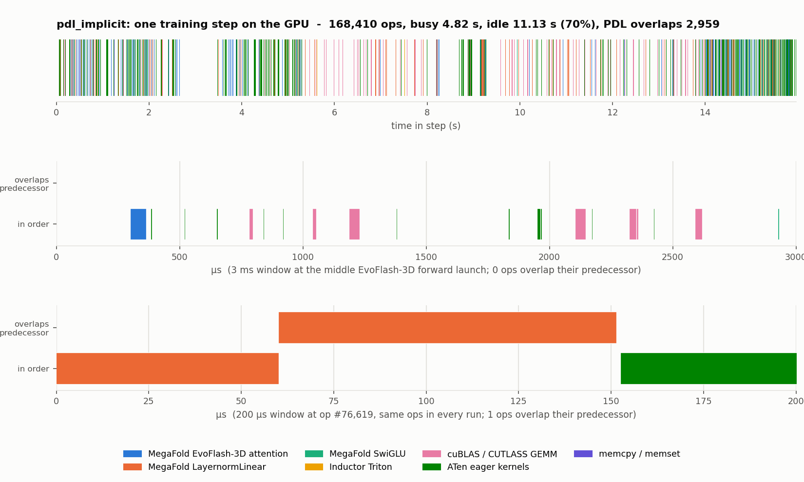
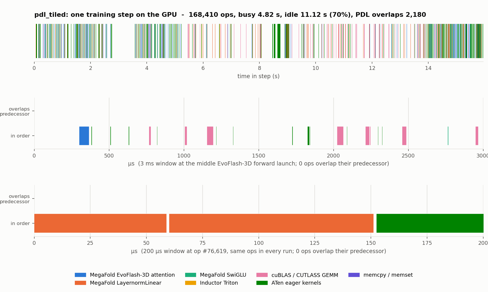
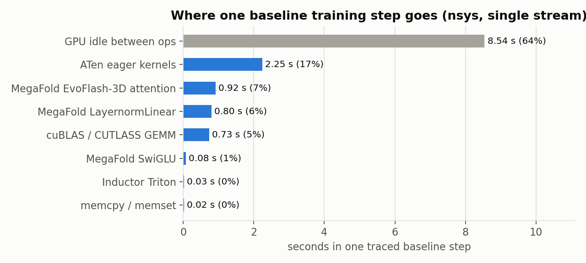
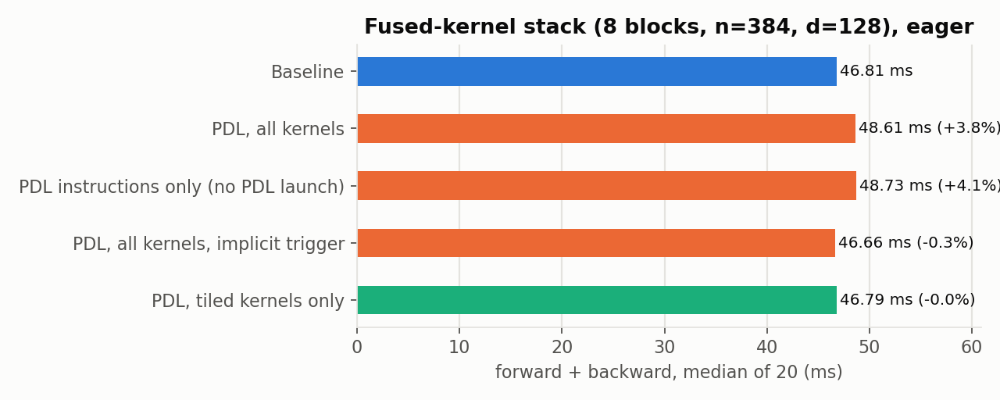
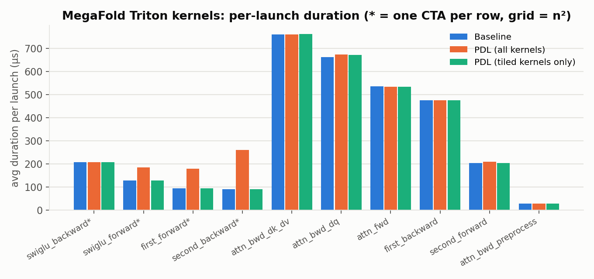

# Report 1 — CUDA Programmatic Dependent Launch (PDL) for a MegaFold training step on one GH200

**Bottom line.** I added PDL to every hand-written MegaFold Triton kernel and to all Triton code
that `torch.compile` generates, made it correct under `torch.compile`, and measured it against the
baseline on one GH200. **End-to-end, PDL makes no measurable difference**: every PDL variant falls
inside the run-to-run noise of the baseline (paired step-time ratio 0.989–0.995, all 95% CIs include
1.0; two identical baseline runs differ by 0.991). The step is **CPU/launch-bound** (GPU idle ≈64% of
a traced step, ~168k GPU ops/step), and only **3.6% of adjacent kernel pairs** are PDL-eligible, so
PDL can affect ≲1% of the step even in the best case. At kernel level, a naive placement of the PDL
trigger *costs* 3.7%; the best placement gains +0.3%.

| | step time, median (s) | paired ratio vs baseline (95% CI) | first step incl. compile (s) | peak mem (GiB) | loss parity |
|---|---|---|---|---|---|
| **Baseline** (primary run, 20 timed steps) | **8.93** (mean 9.02, σ 0.94, min 7.46) | — | 129.7 | 40.15 | — |
| Baseline, interleaved reps 1 / 2 | 9.81 / 9.70 | rep2/rep1: **0.991** [0.976, 1.005] ← noise floor | 130.2 / 129.2 | 40.15 | — |
| PDL, all kernels, early trigger | 9.72 / 9.70 | 0.989 [0.980, 1.001] | 136.5 / 135.0 | 40.15 | ✅ |
| PDL, all kernels, implicit trigger | 9.56 / 9.72 | 0.9935 [0.979, 1.001] | 134.7 / 135.6 | 40.15 | ✅ |
| PDL, tiled kernels only | 9.55 / 10.33 | 0.995 [0.987, 1.052] | 138.1 / 140.9 | 40.15 | ✅ |

*Paired ratio:* every step index uses an identical RNG stream in every variant (the per-step work
varies with the step's random draws), so each PDL step is divided by the same step of the baseline run
from the same interleaved repetition; 2 reps × 10 steps = 20 ratios; bootstrap CI of the median.



---

## 1. Setup

| | |
|---|---|
| Hardware | NCSA DeltaAI, 1× NVIDIA GH200 120GB (H100-class sm_90, 96 GB HBM3 visible), Grace CPU, driver 595.71 |
| Software | PyTorch 2.10.0+cu129, Triton 3.6.0, CUDA 12.9, Python 3.12 (`python/miniforge3_pytorch/2.10.0`) |
| Model | MegaFold AlphaFold3, `configs/megafold_1x1.yaml` (`use_optimized_evo: triton`, 48-block Pairformer, activation checkpointing as configured), 509,004,585 parameters |
| MegaFold kernels | EvoFlash-3D attention, fused LayerNorm-Linear and fused SwiGLU Transition all active (nsys: ~2.9k / 6.7k / 1.9k launches per step) |
| Input | batch size 1, **384 tokens** (single protein chain, 3,481 atoms), MSA depth 512, 4 templates — fixed synthetic example collated by MegaFold's own `collate_inputs_to_batched_atom_input` (the PDB data / MSA caches are not on the system; the step's compute is shape-, not value-dependent) |
| Training step | exactly what `megafold/trainer.py` does per step: `loss = model(**batch, dtype=bf16, return_loss_breakdown=True, call_confidence_head=False)`, `loss.backward()`, `clip_grad_norm_(10)`, `Adam(lr=1e-4).step()`, `zero_grad()` (DeepSpeed ZeRO-0 in the 1x1 config is equivalent) |
| Compile | `torch.compile(model, dynamic=False)`, **`TORCH_COMPILE_DEBUG=1`** for every run, cold Triton/Inductor caches per run |
| Method | `benchmarks/train_step_bench.py`; wall time per step with `cuda.synchronize()`; warm-up steps excluded; variants interleaved on one node |

**Changes required to run the 1x1 training step under `torch.compile` at all** (applied to *both*
baseline and PDL; MegaFold ships `use_torch_compile=False`, so this path had never been exercised):

1. `megafold/model/FusedTransition/fused_transition.py` — the SwiGLU backward wrote the gradient
   *in place into the saved forward input* and returned it. aot-autograd forbids in-place mutation of
   a view produced by another custom `autograd.Function`. The kernel now writes `dx` into a fresh
   buffer (same bytes read/written as before).
2. `megafold/distributed/comm.py` — `scatter`/`gather` are the identity when there is one
   sequence-parallel rank; they now return the input directly instead of routing it through a custom
   `autograd.Function` (returning an input from a Function creates an alias torch.compile rejects).
3. Harness: `dynamic=False` (Dynamo 2.10 crashes tracing MegaFold's Triton launches once a dimension
   becomes symbolic: `SymNodeVariable has no attribute value`), and `CXX=g++` (DeltaAI's PrgEnv sets
   `CXX=CC`, the Cray wrapper, which breaks Inductor's C++ codegen).

## 2. Baseline

Primary baseline (cold caches, 3 warm-up + 20 timed steps): **median 8.93 s/step** (mean 9.02 s,
σ 0.94 s, min 7.46 s); first step including compilation 129.7 s; peak allocated memory 40.15 GiB.
The ±10% step-to-step spread is *deterministic* (it reproduces step-for-step across runs): it comes
from the per-step random draws of AF3 training (e.g. the number of recycling iterations), which is
why all comparisons are paired by step index. Separately, whole runs drift by up to ~3% on the shared
node, which is why variants are interleaved.

## 3. Where and how PDL was applied

PDL (Hopper+, `cudaLaunchAttributeProgrammaticStreamSerialization`) lets kernel *N+1* on a stream be
**launched while kernel *N* is still running**. *N+1*'s CTAs are scheduled once every CTA of *N* has
executed `griddepcontrol.launch_dependents` (or exited); they run their prologue and block in
`griddepcontrol.wait` until *N* has fully completed and flushed memory. It hides launch latency and the
predecessor's tail; it does not reduce the number of launches or their CPU cost.

### 3.1 MegaFold's hand-written Triton kernels (all 10)

Mechanism (`megafold/model/pdl.py`): a global `tl.constexpr` gate and a `@triton.jit` prologue called as
the **first statement** of every kernel, plus `launch_pdl=` at every launch site (12 sites):

```python
@triton.jit
def pdl_prologue():
    if USE_PDL:                                  # constexpr: compiled out when MEGAFOLD_PDL is unset
        tl.extra.cuda.gdc_wait()                 # griddepcontrol.wait  - before ANY global load/store
        if EARLY_TRIGGER:
            tl.extra.cuda.gdc_launch_dependents()  # griddepcontrol.launch_dependents

_attn_fwd[grid](..., launch_pdl=LAUNCH_PDL)      # cudaLaunchKernelEx + programmatic serialization
```

| kernel | file | role | grid (n = 384) | class |
|---|---|---|---|---|
| `_attn_fwd` | `FusedEvoAttention/evoattention.py` | EvoFlash-3D attention forward | (n/16, b·s·h) tiles | tiled |
| `_attn_bwd_preprocess` | 〃 | D = rowsum(dO∘O) | (n/32, b·s·h) | tiled |
| `_attn_bwd_dk_dv` | 〃 | dK, dV (+ d pair-bias, atomics) | (n/64, b·s·h) | tiled |
| `_attn_bwd_dq` | 〃 | dQ | (n/16, b·s·h) | tiled |
| `_second_forward_kernel` | `FusedLayernormLinear/fused_layernorm_linear.py` | normalize + matmul | M/BM · N/BN tiles | tiled |
| `_first_backward_kernel` | 〃 | dY·Wᵀ, dW (atomics) | M/BM · K/BK tiles | tiled |
| `_first_forward_kernel` | 〃 | LayerNorm mean / rstd | **(M,)**, one row per CTA, M = n² = 147,456 | row-wise |
| `_second_backward_kernel` | 〃 | LayerNorm dX | **(M,)** | row-wise |
| `_swiglu_forward_kernel` | `FusedTransition/fused_transition.py` | silu(b)·a | **(M,)** | row-wise |
| `_swiglu_backward_kernel` | 〃 | d(a, b) | **(M,)** | row-wise |

**Why it is safe.** `gdc_wait` precedes every global memory access, so a kernel can never read data its
predecessor has not finished writing (RAW) nor overwrite data the predecessor still reads (WAR). The
early trigger only affects *scheduling*: a dependent's `gdc_wait` always waits for full completion.
Kernels not launched with PDL keep normal stream ordering. Verified: forward outputs and loss are
bitwise identical to the baseline; gradients differ only at the level of the baseline's own run-to-run
noise (the LayerNorm-Linear and attention backward accumulate with float atomics, so even two baseline
runs are not bitwise identical) — `results/kernels_compare*.json`. PTX check: `griddepcontrol` appears
in 0/10 baseline kernels and 10/10 PDL kernels (`results/ptx_griddepcontrol.txt`).

Policy knobs (all read at import): `MEGAFOLD_PDL=1` enables; `MEGAFOLD_PDL_KERNELS=all|tiled`;
`MEGAFOLD_PDL_TRIGGER=early|implicit` (implicit = no explicit trigger; dependents are released as CTAs
exit); `MEGAFOLD_PDL_LAUNCH=0` (diagnostic: instructions compiled in, normal launch).

### 3.2 Kernels generated by `torch.compile` (Inductor)

`torch._inductor.config.triton.enable_pdl = True` makes Inductor insert `gdc_wait()` before the first
load and `gdc_launch_dependents()` after the last load of every generated Triton kernel and launch them
with `launch_pdl`. In each PDL run 135 of 153 compiled graphs contain PDL code (~448 `gdc_wait` sites,
~462 kernels launched with `launch_pdl=True`); the baseline has none.

### 3.3 Two bugs that had to be fixed for PDL to work at all

1. **Inductor PDL codegen crash** (PyTorch 2.10): `_handle_pdl_after_load` calls `cse.generate(...)`
   without `shape=`, so every kernel with a load fails with `AssertionError: TritonCSEVariable must
   have shape`. Fixed in the harness by passing `shape=()` (the generated value is the scalar `0`).
2. **Silent NaN loss — PDL instructions break Inductor's mutation analysis.** Under `torch.compile`,
   Dynamo traces MegaFold's Triton launches into the graph (`triton_kernel_wrapper_functional`), and
   Inductor statically analyses each kernel's TTIR to learn which pointers it writes. A non-pure
   `tt.elementwise_inline_asm` — which `gdc_wait`/`gdc_launch_dependents` are, by necessity — makes
   that analysis bail out to "every input is mutated", and on this model that fallback produced
   uninitialised outputs (NaN loss from step 0, **even with PDL launches disabled**). Isolated, the
   same kernels are correct, which is why the kernel-level check did not catch it. Diagnosis: a NaN
   tracer on the fused `autograd.Function`s pinpointed SwiGLU/LayerNorm-Linear calls returning
   non-finite outputs from finite inputs; the FX graphs showed `x_ptr`/`X_ptr` newly in
   `tensors_to_clone`. Fix (`megafold/model/pdl.py`): before the analysis, drop inline-asm ops that
   have **no operands** (they receive no pointer, so they cannot mutate a parameter). Inductor then
   infers exactly the baseline's mutation sets (`results/mutation_analysis_check.txt`) and the loss
   matches the baseline. All PDL end-to-end numbers measured before this fix were invalid and are
   kept only as evidence in `results/invalid_nan_before_fix/`.

## 4. Profiles of the training step (nsys, one steady-state step per run)

Each figure: top — every GPU op of one training step (blank = GPU idle); bottom — a 3 ms window at the
same logical point in every run, with ops that start before their predecessor ends drawn on the upper
lane (only possible with PDL). nsys inflates the step (~9 s → ~13 s) because ~168k ops are recorded;
proportions, not absolute times, are the point. Raw traces: `results/**/nsys/*.nsys-rep`.

| run | GPU ops | traced step (s) | GPU busy (s) | GPU idle | median gap (µs) | PDL overlaps (count / total ms) | EvoFlash-3D (s) | LayerNorm-Linear (s) | SwiGLU (s) | Inductor (s) | GEMM (s) | ATen eager (s) |
|---|---|---|---|---|---|---|---|---|---|---|---|---|
| Baseline | 168,410 | 13.36 | 4.819 | 8.54 s (64%) | 13.7 | 0 / 0.0 | 0.918 | 0.799 | 0.075 | 0.027 | 0.731 | 2.246 |
| PDL, all kernels, early trigger | 168,410 | 15.67 | 5.218 | 10.45 s (67%) | 20.9 | 4,339 / 18.7 | 0.922 | 1.193 | 0.099 | 0.028 | 0.730 | 2.244 |
| PDL, all kernels, implicit trigger | 168,410 | 15.96 | 4.824 | 11.13 s (70%) | 23.3 | 2,959 / 0.7 | 0.923 | 0.801 | 0.075 | 0.028 | 0.730 | 2.246 |
| PDL, tiled kernels only | 168,410 | 15.95 | 4.825 | 11.12 s (70%) | 24.1 | 2,180 / 1.7 | 0.925 | 0.801 | 0.075 | 0.028 | 0.730 | 2.245 |

The op sequence is identical in every run (168,410 ops). PDL produces thousands of real overlaps, but they total at most 18.7 ms of a ~13–16 s traced step. With the early trigger, GPU busy time *rises* by 0.4 s — almost entirely LayerNorm-Linear (+0.39 s) and SwiGLU (+0.02 s), whose row-wise kernels pay the per-CTA trigger cost; Inductor, GEMM and ATen time are unchanged. With the implicit trigger or tiled-only policy, busy time equals the baseline's to within 6 ms. The traced span differences (13.4 s vs ~15.9 s) are idle time, i.e. CPU-side; they vary between nsys sessions and are not a PDL effect (the untraced, interleaved measurements in the summary table show no difference).


**Baseline**


**PDL, all kernels, early trigger**


**PDL, all kernels, implicit trigger**


**PDL, tiled kernels only**


Where the baseline step goes:



## 5. Why PDL cannot pay off here

From the baseline trace (`results/baseline/nsys/`):

* **The step is CPU/launch-bound.** 168,410 GPU ops per step; the GPU is idle 64% of the traced
  step (untraced: 9.1 s wall vs 4.8 s of GPU work). The median inter-op gap (13.7 µs, p90 101 µs, p99
  306 µs) is the CPU not having issued the next op yet. PDL can only overlap a kernel that is already
  queued behind its predecessor.
* **Almost nothing is PDL-eligible.** PDL needs *both* neighbours to be PDL-aware Triton kernels.
  65% of ops are eager ATen kernels (`vectorized_elementwise_kernel` etc. — `torch.compile` leaves most
  of the model eager because of graph breaks: only 2,660 Inductor kernels per step, 1.6%), plus 35k
  cuBLAS/CUTLASS GEMMs. Only **6,035 of 168,409 adjacent pairs (3.6%)** are Triton→Triton.
* **The eligible pairs are already back-to-back**: median gap 1.2 µs, 110 ms of the 8,541 ms of total
  gap time. That is the ceiling for PDL on this step: ≲1%.

## 6. Kernel-level analysis: the trigger placement matters

Eager stack of 8 pairformer-shaped blocks (LayerNorm-Linear → EvoFlash-3D triangle attention → SwiGLU
Transition, n = 384, d = 128), forward + backward, median of 20 (`benchmarks/pdl_kernel_check.py`):

| variant | ms | vs baseline 46.81 ms |
|---|---|---|
| PDL, all kernels, early trigger | 48.61 | **−3.7%** |
| PDL instructions only, normal launch | 48.73 | −3.9% |
| PDL, all kernels, implicit trigger | 46.66 | **+0.3%** |
| PDL, tiled kernels only | 46.79 | ±0.0% |



The PDL overlap itself works (320 kernel overlaps per 5 iterations in nsys, idle between kernels down
from 4.56 to 3.93 ms), but in the early-trigger variant the **row-wise kernels get much slower**:
`_first_forward_kernel` +89%, `_second_backward_kernel` +187%, `_swiglu_forward_kernel` +43%; tiled
kernels are within 0–2.5%. The "instructions only" variant is just as slow, so the cost is
**executing `griddepcontrol.launch_dependents` in each of ~147k tiny CTAs**, not the scheduling; with
the implicit trigger (`gdc_wait` only) the penalty disappears. Lesson: on kernels with many short CTAs,
do not trigger explicitly — let CTA exit release the dependent.



## 7. Caveats

* Synthetic input (no PDB data / MSA caches on the system); the compute graph and shapes match a
  384-token crop, values do not affect kernel timing, and identical inputs make variants comparable.
* `call_confidence_head=False` for every step (the trainer calls it every 10th step).
* nsys adds ~45% to the step; the gap/eligibility figures are proportions of a traced step.
* The ~1% median differences end-to-end are within run-to-run noise; resolving effects of that size
  would need many more interleaved repetitions than one 2-hour allocation allows.

## 8. Reproduce

```bash
# environment (DeltaAI): module load python/miniforge3_pytorch/2.10.0; conda activate base;
#   python -m venv --system-site-packages ~/venvs/megafold; pip install -r requirements (see README)
sbatch scripts/hold_node.sh                       # holds one GH200 (ghx4-interactive, 2 h)
srun --jobid=<id> --overlap -n1 bash scripts/run_investigation.sh   # kernel-level variants
srun --jobid=<id> --overlap -n1 bash scripts/run_e2e_final.sh       # interleaved e2e + nsys
python benchmarks/make_report.py; python benchmarks/plot_profiles.py name=<trace.csv> ...
```
Baseline runs use a checkout with the original kernels (`BASE_TREE`, commit `0c97c88` of this history);
PDL runs use this tree with `MEGAFOLD_PDL=1`.
