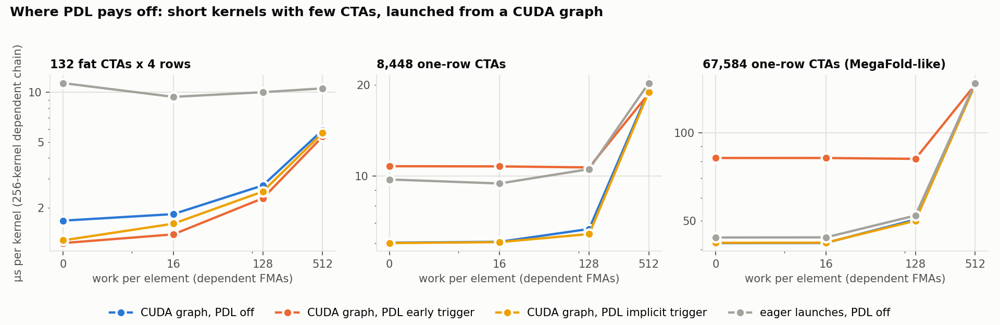

# Report 2 — What would make PDL impactful for MegaFold?

**Short answer.** PDL saves ~0.4–0.5 µs per kernel boundary, and only when (1) the next kernel is
already queued on the GPU — i.e. launches come from a CUDA graph, not from Python — (2) both kernels are
PDL-aware Triton kernels, and (3) the grid is small or uses the implicit trigger. MegaFold's training
step violates all three, and the root cause is one thing: **under `torch.compile`, MegaFold's
activation-checkpointed layers (Pairformer, diffusion token transformer, MSA module) still run as
~100k individually launched eager kernels per step** (97k in backward, 61k in forward), so the step
is CPU-launch-bound and PDL never sees two adjacent Triton kernels. The modifications, in order:

1. **Make the checkpointed trunk compile** (compile each block *inside* the checkpoint, or use
   compile-native activation checkpointing). This is what turns 100k eager launches into a few hundred
   fused Triton kernels.
2. **Register MegaFold's Triton kernels as custom ops with declared mutations** (`torch.library.triton_op`
   / `wrap_triton`). Every attempt to pull these kernels into compiled graphs — PDL instrumentation
   (Report 1) and compiling without checkpointing (here) — hit the same fragile TTIR mutation
   analysis and produced NaNs or in-place errors on weights. This is the enabler for 1 and for PDL.
3. **CUDA graphs** over the compiled trunk and diffusion transformer, with cuSOLVER SVD/eigh and
   `.item()` syncs kept outside the captured regions.
4. **Reshape the row-wise kernels to few, fat CTAs** and use the implicit trigger on any many-CTA grid.

Even with all four, PDL itself is worth only an estimated ~1–2% of the step; modifications 1–3 are
worth far more by themselves (roughly half the current wall time is CPU-side). Everything below is
measured on the Report 1 setup (1× GH200, PyTorch 2.10, Triton 3.6, bs = 1, 384 tokens).

---

## 1. Recap: why PDL did not matter (Report 1)

| obstacle | measurement (one training step) |
|---|---|
| CPU-launch-bound | 168,410 GPU ops; GPU idle 64% of the traced step; untraced 9.1 s wall vs 4.8 s GPU work |
| few PDL-eligible boundaries | 3.6% of adjacent pairs are Triton→Triton; 65% of ops are eager ATen kernels, 21% cuBLAS/CUTLASS |
| eligible boundaries already tight | median gap 1.2 µs (110 ms of 8.5 s total gap) |
| trigger cost on row-wise kernels | early `launch_dependents` makes the one-row-per-CTA kernels 43–187% slower |

## 2. Experiment A — the regime in which PDL pays off

`benchmarks/pdl_regime_sweep.py`: 256 truly dependent Triton kernels (each reads the previous kernel's
output), sweeping per-kernel work and grid shape; PDL off / implicit trigger / early trigger; launched
eagerly or captured in a CUDA graph. Every PDL output is bitwise identical to PDL off.



| kernel shape (work = 0) | eager, PDL off | CUDA graph, PDL off | CUDA graph, PDL implicit | CUDA graph, PDL early |
|---|---|---|---|---|
| 132 fat CTAs × 4 rows | 11.4 µs | 1.67 µs | 1.27 µs (**+24%**) | 1.22 µs (**+27%**) |
| 〃, work = 512 (~6 µs kernel) | 10.6 µs | 5.90 µs | 5.67 µs (+4%) | 5.39 µs (+9%) |
| 8,448 one-row CTAs | 9.8 µs | 6.03 µs | 6.01 µs (0%) | 10.78 µs (**−79%**) |
| 67,584 one-row CTAs (MegaFold-like) | 43.9 µs | 42.1 µs | 42.2 µs (0%) | 82.1 µs (**−95%**) |

1. **Eager launches hide PDL completely**: from Python each Triton launch costs ~10 µs of CPU
   regardless of the kernel, so the GPU waits for the CPU, not for the previous kernel.
2. **In a CUDA graph PDL saves ~0.4–0.5 µs per boundary** — up to 27% for few-µs kernels, a few
   percent for longer ones. That is the ceiling for PDL.
3. **The trigger must fit the grid**: an early trigger in every CTA of a 10⁴–10⁵-CTA grid nearly
   doubles the kernel; the implicit trigger is free but only helps grids of about one wave.

## 3. Experiment B — where the ~100k eager kernels come from

**Graph-break census** (`torch._dynamo.explain`, one forward, static shapes): 122 breaks / 123 graphs.
Top cause: **35** breaks from `is_cuda()` in `FusedLayernormLinear` (queries the Triton driver on every
call), then 16 from `lens_to_mask` (data-dependent size), 4 `batch_repeat_interleave`, 3 frame averaging.
I fixed `is_cuda()` (evaluated once at import): **122 → 99 breaks** (deeper code becomes traceable and
exposes 13 DeepSpeed `memory_allocated` calls and 5 sequence-parallel `comm` backward breaks). But the
kernel mix barely moved (eager ATen kernels 108,930 → 108,520; Inductor 2,660 → 2,936) — graph breaks
in the forward are **not** where the eager kernels come from.

**Attribution by launch time** (`benchmarks/attribute_nvtx.py`): NVTX ranges on every top-level
submodule plus backward / optimizer, each kernel matched to the CPU timestamp of its launch:

| phase | kernels | GPU time |
|---|---|---|
| backward | **97,406 (61%)** | 2.52 s |
| forward + loss | 60,731 (38%) | 2.31 s |
| clip + optimizer | 560 | 0.02 s |

| forward kernels launched inside | count |
|---|---|
| `pairformer` (48 blocks) | **31,698** |
| `diffusion_module.token_transformer` | **15,600** |
| `msa_module` | 2,988 |
| `diffusion_module.atom_encoder` / `atom_decoder` | 2,301 / 2,301 |
| everything else (embedders, heads, loss, EDM glue) | ~5,800 |

The heavy modules are exactly the ones whose layers are wrapped in
`checkpoint(layer_wrapper, inputs)` (non-reentrant `torch.utils.checkpoint` around Python closures).
Their kernels are launched one by one in the forward *and* again during backward recomputation and
gradient computation — even when the module itself is wrapped in `torch.compile` (next section: only
33 CUDA-graph launches and 99 Inductor kernels remain). **The compiled region does not cover the
checkpointed layers**; that is the source of the CPU-bound step.

## 4. Experiment C — CUDA graphs on the real training step

* **Whole model, `mode="reduce-overhead"`: fails.** Steps 0–1 run (142 s / 13 s while graphs are
  recorded); capture then fails in the loss path — the stochastic frame averaging's 3×3
  `torch.linalg.eigh` (`CUSOLVER_STATUS_INTERNAL_ERROR`) and, after excluding it, the Kabsch alignment
  `weighted_rigid_align` (SVD: `operation not permitted when stream is capturing`). The model has ~40
  such sites (cuSOLVER SVD/eigh, `.item()`/`.tolist()` syncs in losses and permutation alignment).
* **Selective CUDA graphs** (`--compile-mode cg-selective`: `reduce-overhead` on Pairformer, MSA module,
  template embedder and the diffusion module's three transformers; loss/alignment eager) **run
  correctly** (12 cudagraph trees recorded) but give **no speedup** — per-step ratio vs the default
  compile 0.98–1.05 — and the trace shows why: 33 `cudaGraphLaunch` vs **119,491 eager
  `cudaLaunchKernel`** calls per step, 112k eager ATen kernels, GPU idle 66%. The graphs capture only the
  thin compiled glue around the eager checkpointed layers.
* **PDL inside selective CUDA graphs** (all kernels, implicit trigger): losses identical to the
  CUDA-graph baseline (7.65581 / 7.35595 …); paired step ratio median 1.007 over 4 steps — no effect,
  as expected when the captured part is this small (single repetition; indicative only).
* **Without activation checkpointing** the trunk *is* traced into the graph — and the MegaFold kernels
  fail Inductor's TTIR mutation analysis (a dtype mismatch on the traced autocast path), the fallback
  marks every input including the weights as mutated, and the step dies with "a leaf Variable that
  requires grad is being used in an in-place operation". Same failure mode as the PDL NaN bug in
  Report 1, reached by a different route.

## 5. Recommended modifications, ranked

| # | modification | what it fixes | expected effect |
|---|---|---|---|
| 1 | **Compile the checkpointed layers**: compile each Pairformer / transformer block and wrap the *compiled* block in `checkpoint`, or replace manual checkpointing with compile-native selective activation checkpointing (`torch._functorch.config.activation_memory_budget`) | ~100k eager launches per step (Pairformer 31.7k + token transformer 15.6k in forward alone, ×~2 in backward) | the step stops being CPU-bound; ATen elementwise chains fuse into Inductor Triton kernels — and those boundaries become PDL-eligible |
| 2 | **Register MegaFold kernels as `torch.library.triton_op` / `wrap_triton` with declared mutations** | the fragile TTIR mutation analysis that broke under PDL instrumentation (NaN) and under full tracing (in-place on weights) | correctness by construction; prerequisite for 1; lets Inductor launch them inside graphs with `enable_pdl` |
| 3 | **CUDA graphs** over the compiled trunk/diffusion transformer; move cuSOLVER SVD/eigh and `.item()` syncs out of captured regions; one captured variant per recycling count / crop bucket | CPU launch latency for whatever remains | the regime where PDL's ~0.5 µs/boundary saving becomes reachable |
| 4 | **Few, fat CTAs for the row-wise kernels** (LayerNorm stats / dX, SwiGLU fwd/bwd: several rows per CTA, ~1 wave) and the implicit trigger on many-CTA grids | the per-CTA `launch_dependents` cost; "only one-wave grids benefit" | early-trigger PDL helps instead of hurts; usually faster on its own |
| 5 | Remove remaining graph breaks: cached `is_cuda()` (done, −35), static `lens_to_mask` (16), no DeepSpeed memory queries in forward (13), static `batch_repeat_interleave` (4) | smaller compiled graphs, host syncs | moderate; needed for clean CUDA-graph capture |
| 6 | Prologue overlap: load LayerNorm affine params / weight tiles before `gdc_wait` | only parameters qualify; every other input is the predecessor's output | small; only after 1–4 |
| 7 | Triton GEMMs where cuBLAS breaks chains (Inductor `max-autotune`) | 35k cuBLAS/CUTLASS kernels sit between Triton kernels | more PDL-eligible boundaries; GEMM speed must be verified |

**How big can PDL get after all of that?** Experiment A puts PDL's saving at ~0.4–0.5 µs per boundary
once launches come from a CUDA graph. Even if all ~168k boundaries of today's step were PDL-eligible,
that is ~80 ms against ~4.8 s of GPU work (≈1.7%; an estimate from the measurements, not a
measurement), and modification 1 removes most of those boundaries by fusion. **For MegaFold, PDL is a
second-order optimisation; the changes needed to make it reachable are first-order ones.**

## 6. Reproduce

```bash
srun --jobid=<holder> --overlap -n1 bash scripts/run_report2.sh              # sweep, census, CUDA graphs
python benchmarks/train_step_bench.py --mode baseline --compile-mode cg-selective --nvtx-modules ...  # under nsys
nsys export --type sqlite -o cgsel_nvtx.sqlite results/report2/nsys/cgsel_nvtx.nsys-rep   # .sqlite is not committed
python benchmarks/attribute_nvtx.py cgsel_nvtx.sqlite --out attribution.json
python benchmarks/make_report2_figs.py
```
Raw data: `results/report2/` (sweep, graph-break censuses, CUDA-graph runs, NVTX attribution, traces).
The `is_cuda()` fix in `megafold/model/FusedLayernormLinear/fused_layernorm_linear.py` was made after
Report 1's measurements (Report 1 numbers correspond to commit `bc7e216`).
