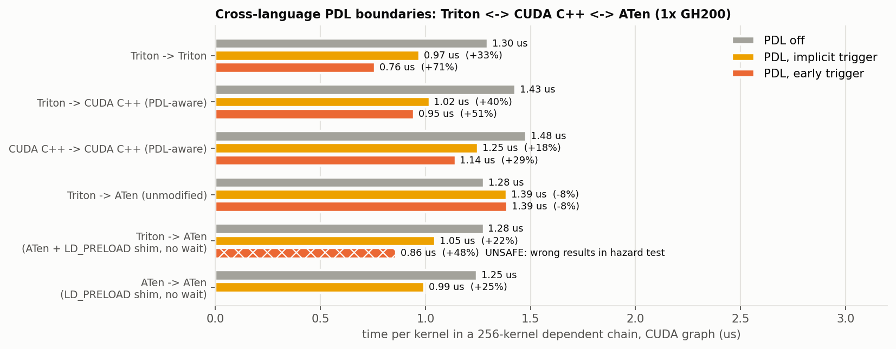
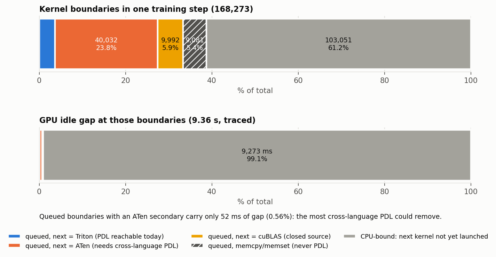

# Report 3: Cross-language PDL (Triton ↔ ATen / cuBLAS / CUDA C++) for a MegaFold training step

**Question.** Only 3.6% of the training step's adjacent kernel pairs are Triton → Triton, the only pairs
Report 1 made PDL-capable. Most boundaries involve PyTorch's eager ATen kernels (C++/CUDA) or cuBLAS.
Can PDL cross from one kernel language to another, e.g. Triton → ATen? Triton's `gdc_wait()` and
`gdc_launch_dependents()` already lower to inline asm, so could an agent inline-asm its way across?

**Short answer.**

1. **Yes, PDL works across kernel languages.** It is a driver and hardware mechanism, not a Triton feature.
   A Triton kernel and a hand-written CUDA C++ kernel form a correct PDL pair in either direction: in a
   CUDA graph, a Triton → CUDA C++ boundary got 40–51% faster for few-µs kernels, with bitwise-identical
   results over 100 randomized trials.
2. **The obstacle for ATen is not the language, but where the two required pieces live.** A PDL boundary
   needs (a) the PDL attribute on the *next* kernel's launch call and (b) a `griddepcontrol.wait`
   instruction *inside the next kernel's code*. ATen kernels are precompiled into `libtorch_cuda.so` and
   launched with plain `cudaLaunchKernel`, so they have neither. Inline asm in the *Triton* kernel cannot
   supply (b), because the missing instruction has to be in the ATen kernel.
3. **I could add (a) from outside PyTorch, but not (b).** An `LD_PRELOAD` shim rewrites every ATen
   launch into a PDL launch, and ATen kernels then really do start early. But they cannot wait. With
   an early trigger in the preceding kernel (MegaFold's early mode, and Inductor's PDL code, which
   triggers right after its last load), the ATen kernel read stale data in **200 of 200 trials**. With
   implicit triggers only, it was correct in every trial (4 × 200), but CUDA does not guarantee that.
4. **cuBLAS** contains internal PDL machinery but, as PyTorch calls it, neither starts early nor triggers
   early, and it has no public switch for PDL.
5. **It would not speed up MegaFold anyway.** Even the most aggressive version — every ATen kernel made
   PDL-capable on the real step — gives **no speedup: the step was 1.5% slower**
   (paired ratio 1.015, 95% CI 1.006–1.025, with losses equal to PDL off). The boundary census shows why:
   - Only 39% of boundaries have the next kernel already queued when the previous one finishes; the
     rest are CPU-bound.
   - The queued boundaries before an ATen kernel hold **52 ms of GPU idle gap out of 9.36 s (0.56%)**.
     That is the most cross-language PDL could remove.

   The 3.6% is a symptom. The cause is that the step is launch-bound (Report 2).

Setup: as in Reports 1–2 (1× GH200 on DeltaAI, PyTorch 2.10.0+cu129, Triton 3.6.0, driver 595.71, bs = 1,
384 tokens). New code: `benchmarks/pdl_xlang/` (the CUDA C++ extension and the shim),
`benchmarks/pdl_cross_language.py`, `benchmarks/pdl_xlang_hazard.py`, `benchmarks/boundary_census.py`.

---

## 1. What a PDL boundary actually needs

For consecutive kernels P (the *primary*) → S (the *secondary*) on one stream:

| piece | where it lives | Triton | CUDA C++ | ATen (precompiled) | cuBLAS |
|---|---|---|---|---|---|
| (a) `cudaLaunchAttributeProgrammaticStreamSerialization` on **S's launch** | host, per launch call | `launch_pdl=True` (via `cuLaunchKernelEx`) | `cudaLaunchKernelEx` + attribute | ✗ plain `cudaLaunchKernel` (108,514 launches/step) | internal; not enabled by default |
| (b) `griddepcontrol.wait` in **S's code** before reading P's output | device, inside S | `tl.extra.cuda.gdc_wait()` = inline asm | `asm volatile("griddepcontrol.wait;" ::: "memory")` | ✗ not in the binary | internal (`ProgrammaticGridSync` in `libcublasLt`) |
| (c) optional `griddepcontrol.launch_dependents` in **P's code** | device, inside P | `gdc_launch_dependents()` | `asm volatile("griddepcontrol.launch_dependents;")` | ✗ (implicit trigger at completion) | not observed |

PDL never involves the two kernels' languages, only these three pieces. The secondary needs both (a)
and (b); the primary needs nothing, because without (c) it triggers implicitly as its blocks finish.
So:

* **ATen → Triton** already works today and is exercised in Reports 1–2: the Triton secondary brings
  (a) and (b).
* **Triton → ATen** needs (a) and (b) on the ATen kernel. Making the Triton side smarter (inline asm or
  anything else) cannot help, because nothing in P can stand in for the `griddepcontrol.wait` that S
  lacks.

`cudaStreamSetAttribute(stream, ProgrammaticStreamSerialization)` is rejected (`cudaErrorInvalidValue`):
the attribute is per launch only, so there is no stream-wide switch.

## 2. Experiment E1: which secondaries actually start early?

The primary P is a 1-block Triton kernel that executes `gdc_launch_dependents()` first and then computes
for 13.7 µs. S is an *independent* kernel of each kind, and 20 (P; S) pairs are captured in a CUDA graph.
If S's launch carries the PDL attribute, S runs underneath P and the pair costs about max(P, S) instead
of P + S.

| secondary S | S alone | P then S | S overlapped with P? |
|---|---|---|---|
| Triton, `launch_pdl=True` | 38.8 µs | 40.2 µs | **yes** (90% of P hidden) |
| Triton, `launch_pdl=False` | 39.0 µs | 52.9 µs | no |
| CUDA C++, `cudaLaunchKernelEx` + PDL attribute | 68.3 µs | 69.8 µs | **yes** (89%) |
| CUDA C++, no attribute | 68.5 µs | 82.4 µs | no |
| ATen `add` (`vectorized_elementwise_kernel`) | 39.2 µs | 52.8 µs | no |
| ATen `sum` (`reduce_kernel`) | 23.8 µs | 37.5 µs | no |
| ATen `copy_` | 38.9 µs | 52.5 µs | no; it is a `cudaMemcpyAsync`, not a kernel |
| cuBLAS bf16 GEMM 4096³ / fp32 GEMM 2048³ | 218 / 347 µs | 261 / 367 µs | no¹ |
| **ATen `add` + `LD_PRELOAD` shim** | 38.9 µs | 40.3 µs | **yes** (90%) |
| **ATen `sum` + `LD_PRELOAD` shim** | 23.6 µs | 27.2 µs | **yes** (74%) |
| ATen `copy_` / cuBLAS GEMM + shim | | | no; memcpy, or cuBLAS launches through the driver API |

¹ P + S is exceeded because the 1-block P occupies an SM that the persistent GEMM wants.

**The shim** (`benchmarks/pdl_xlang/pdl_shim.c`, about 40 lines of C) interposes `cudaLaunchKernel`,
which is what every `<<<>>>` launch in `libtorch_cuda.so` calls. When it is switched on, it re-issues the
launch as `cudaLaunchKernelExC` with the PDL attribute. This needs no rebuild of PyTorch, but it supplies
only piece (a).

## 3. Experiment E2: which primaries trigger early?

The primary P is a long kernel of each kind. The secondary S is a PDL-launched CUDA C++ probe that records
`%globaltimer` on entry and again after `griddepcontrol.wait`. A long wait means the probe was already
running while P was still running, i.e. P triggered early.

| primary P | P duration | probe's wait | triggers early? |
|---|---|---|---|
| Triton, `gdc_launch_dependents` first (positive control) | 83 µs | 51 µs | **yes** |
| Triton, no trigger (negative control) | 80 µs | 0.0 µs | no |
| CUDA C++, `launch_dependents` first | 73 µs | 62 µs | **yes** |
| ATen `add` (512 MiB), ATen `sum` | 309 µs, 172 µs | 0.13 µs | no |
| cuBLAS bf16 GEMM 8192³ | 1,520 µs | 0.13 µs | no |
| cuBLAS bf16 GEMM 256×256, K = 65,536 (few blocks) | 54 µs | 0.0 µs | no |

ATen kernels can only ever be implicit-trigger primaries. As PyTorch calls it, cuBLAS behaves the
same way: its internal PDL support is not active.

## 4. Experiment E3: dependent chains across languages, in a CUDA graph

The chain has 256 kernels, each reading the previous kernel's output (132 blocks × 512 floats, so the
kernels take a few µs). Kernel kinds alternate per pattern, and the chain is captured in a CUDA graph.
Each configuration was checked against PDL off on 100 random inputs.



| chain | PDL off | implicit trigger | early trigger | bitwise equal to PDL off |
|---|---|---|---|---|
| Triton → Triton | 1.30 µs | 0.97 µs (+33%) | 0.76 µs (+71%) | 100/100 |
| **Triton → CUDA C++ (PDL-aware)** | 1.43 µs | 1.02 µs (**+40%**) | 0.95 µs (**+51%**) | 100/100 |
| CUDA C++ → CUDA C++ (PDL-aware) | 1.48 µs | 1.25 µs (+18%) | 1.14 µs (+29%) | 100/100 |
| Triton → ATen (unmodified) | 1.28 µs | 1.39 µs (−8%) | 1.39 µs (−8%) | 100/100 |
| Triton → ATen (shim, no wait) | 1.28 µs | 1.05 µs (+22%) | 0.86 µs (+48%), **unsafe**, see below | 100/100 (*) |
| ATen → ATen (shim, no wait) | 1.25 µs | 1.00 µs (+25%) | n/a | 100/100 |

* **Cross-language PDL is real.** The Triton → CUDA C++ boundary gains as much as Triton → Triton.
* **Unmodified ATen in the chain: no gain.** Turning PDL on for only the Triton half of a Triton ↔ ATen
  chain made it 8% *slower*: the ATen → Triton boundaries should benefit, but the net effect was
  negative. I did not isolate the cause.
* **(*) The shim's early-trigger result is a coincidence of timing.** Here the primary's stores land
  within about 1 µs of its trigger, which is less than the secondary's launch latency. The hazard test
  below widens that window.

### Hazard test: an ATen kernel that cannot wait

The Triton primary performs WORK dependent FMAs per element *before* its stores, so it writes late. The
output buffer is pre-filled with NaN, so any read of not-yet-written data shows up as a wrong result.
200 trials per cell (`benchmarks/pdl_xlang_hazard.py`):

| primary's trigger | WORK | ATen `add` + shim (no wait) | CUDA C++ PDL-aware (waits) |
|---|---|---|---|
| early | 0 | 0/200 wrong | 0/200 |
| early | 64 | **200/200 wrong** (5.9% of elements) | 0/200 |
| early | 512 | **200/200 wrong** (8.5%) | 0/200 |
| early | 4096 | **200/200 wrong** (15.0%) | 0/200 |
| implicit | 0 / 64 / 512 / 4096 | 0/200 each | 0/200 each |

* **Early trigger: wrong every time.** Forcing PDL onto a kernel that cannot wait is a data race as soon
  as any predecessor triggers early.
* **Implicit trigger: correct in every trial, but not guaranteed.** The trigger then fires only as the
  primary's blocks exit, and it never failed here. But the CUDA programming model guarantees that the
  primary's writes are visible only after `griddepcontrol.wait` (`cudaGridDependencySynchronize`), so this
  is unsupported behaviour that merely worked on this driver and GPU.
* **Inductor is affected by default:** its PDL code generation emits `gdc_launch_dependents()` right after
  a kernel's last load (`torch/_inductor/codegen/triton.py`, `_handle_pdl_after_load`). So the shim is
  never safe together with Inductor's PDL.

## 5. The real training step: the boundary census, and every ATen kernel made PDL-capable

### Where PDL could act at all (`benchmarks/boundary_census.py`)

For every same-stream boundary in one traced step, the census records whether the CPU had already
enqueued the secondary when the primary finished. If it had not, the GPU is waiting for the CPU, and
no form of PDL, in any language, can help.



Baseline trace, one step (168,273 boundaries, 9.36 s of total gap while traced):

| boundary class | boundaries | GPU idle gap |
|---|---|---|
| CPU-bound: secondary not yet enqueued | 103,051 (61.2%) | **9,273 ms (99.1%)** |
| queued, secondary ATen (needs cross-language PDL) | 40,032 (23.8%) | **52.0 ms (0.56%)** |
| queued, secondary cuBLAS (closed source) | 9,992 (5.9%) | 12.0 ms |
| queued, memcpy/memset involved (never PDL) | 9,081 (5.4%) | 13.1 ms |
| queued, secondary Triton (PDL-capable today) | 6,117 (3.6%) | 7.5 ms |

* **Report 1's PDL already did its job where it could reach.** In the PDL-all trace, the gap before
  queued Triton secondaries falls from 7.5 ms to **0.33 ms**.
* **Cross-language PDL would raise PDL-capable boundaries from about 4% to about 28%,** but those
  boundaries carry only 52 ms of gap. PDL can also hide some tail time beyond the gap: at the ~0.3–0.5 µs
  per boundary measured above, that is at most another ~15–20 ms. The ceiling is therefore below 1% of
  the 8.9 s step.

### End to end: every ATen kernel as a PDL secondary

Configuration (`scripts/run_report3_e2e.sh`):

* MegaFold's Triton kernels use PDL with the **implicit** trigger;
* Inductor's PDL code generation is **off**, because it triggers early;
* the shim is switched on for the whole run, so **every** `cudaLaunchKernel` is a PDL launch;
* compared with PDL fully off, alternating runs on the same node, 2 runs each, 8 timed steps per run.

| run (2 repetitions × 8 timed steps) | median step | paired ratio vs PDL off (95% bootstrap CI) | final losses (steps 7–9) |
|---|---|---|---|
| PDL off, rep 1 / rep 2 | 8,989 / 9,104 ms | (rep 2 / rep 1: 1.006) | 6.7321, 6.6445, 6.7789 |
| MegaFold PDL (implicit) + **every ATen launch PDL via shim**, rep 1 / rep 2 | 9,279 / 9,178 ms | **1.015 [1.006, 1.025]** | 6.7320, 6.6445, 6.7789 |

* **The shim was really active.** It converted 87k–109k launches per step, essentially all of the ATen
  launches (108.5k per step in the census).
* **No speedup; slightly slower.** The cross-language step was 1.5% *slower*.
  - Part of that is drift: the cross-language run always ran second in each repetition, and the second
    baseline run was itself 0.6% slower than the first.
  - The rest is plausibly the extra CPU work of re-issuing ~100k launches per step through
    `cudaLaunchKernelExC`, in a step that is limited by the CPU. That explanation is not measured
    separately.
* **No sign of corruption.** The losses differ from PDL off by at most 1.5e-4 over all 10 steps. That is
  the same as the difference between the two PDL-off runs (1.5e-4), which comes from nondeterministic
  kernels.
* **This matches the census.** About 100k extra PDL launches buy nothing, because 99% of the step's idle
  gap is the GPU waiting for the CPU to issue the next launch.

## 6. How to get cross-language PDL properly, and whether it is worth it

1. **Replace the ATen kernels with Triton kernels by compiling the checkpointed regions** (Report 2,
   modification 1). This is the recommended route.
   - Inductor's kernels are PDL-capable out of the box, so the language problem disappears.
   - The ~100k eager ATen launches fuse into far fewer kernels.
   - It removes the CPU bottleneck that makes PDL irrelevant today.
2. **Build PyTorch with PDL in the ATen kernel templates.**
   - Add `griddepcontrol.wait` at the top of `vectorized_elementwise_kernel`, `unrolled_elementwise_kernel`,
     `elementwise_kernel` (`ATen/native/cuda/CUDALoops.cuh`) and `reduce_kernel` (`Reduce.cuh`), and
     launch them with `cudaLaunchKernelEx` plus the attribute. Those four templates account for about 97k of the
     roughly 109k ATen launches per step (Report 1's kernel histogram).
   - The wait costs nothing when a kernel is not launched with PDL, so correctness is preserved
     regardless of what precedes it.
   - This is a PyTorch source build (not attempted here), and the most it can buy MegaFold is the 52 ms
     measured above.
3. **The `LD_PRELOAD` shim** is a demonstration tool, not something to deploy. It is only "correct"
   when no kernel triggers early, which rules out Inductor's PDL and MegaFold's early mode, and even
   then it relies on behaviour CUDA does not guarantee.
4. **cuBLAS** would need NVIDIA to expose its internal PDL support.
   - The alternative is Triton or CUTLASS GEMMs: Inductor `max-autotune` (Report 2, modification 7), or
     CUTLASS 3.x, which has explicit PDL support.

**Bottom line.** Cross-language PDL is possible, and I demonstrated it working, but the boundaries it
unlocks hold under 1% of MegaFold's idle time. Today the GPU waits for the CPU, not for the previous
kernel. The modifications that make the step GPU-bound (Report 2) are what would make any form of PDL
matter.

## 7. Reproduce

```bash
# login node: build the shim (the CUDA extension builds on first use)
gcc -O2 -shared -fPIC -I$CUDA_HOME/include benchmarks/pdl_xlang/pdl_shim.c -o benchmarks/pdl_xlang/libpdl_shim.so -ldl
srun --jobid=<holder> --overlap -n1 bash scripts/run_report3.sh            # E1-E4 -> results/report3/cross_language.json
LD_PRELOAD=$PWD/benchmarks/pdl_xlang/libpdl_shim.so python benchmarks/pdl_xlang_hazard.py --out results/report3/hazard.json
srun --jobid=<holder> --overlap -n1 bash scripts/run_report3_e2e.sh        # training step, ATen via shim
python benchmarks/boundary_census.py results/nsys/iscuda_fix_baseline.sqlite --out results/report3/census_iscuda_fix_baseline.json
python benchmarks/make_report3_figs.py
```
Raw data: `results/report3/`; logs: `results/logs/report3_*.log`, `results/logs/r3_e2e_*.log`.
