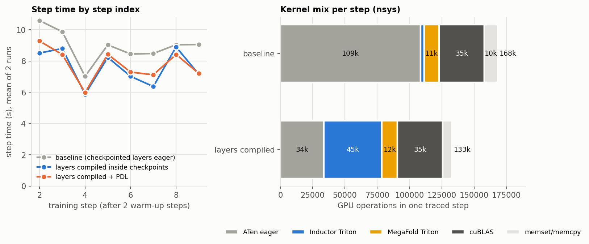

# Report 4: Compiling MegaFold's activation-checkpointed layers, and PDL on top

**Question.** Report 3 named two ways to get PDL across the ATen boundaries properly:

1. Compile the activation-checkpointed layers, so their ATen work becomes Inductor Triton kernels (which
   are PDL-capable).
2. Rebuild PyTorch with `griddepcontrol.wait` added to ATen's kernel templates.

This report implements route 1 on the real training step and measures it, then explains why route 2 was
not built.

**Short answer.**

* **Route 1 works and makes the step about 16% faster at the same memory.** Paired step-time ratio
  0.837 [0.796, 0.896]; median step 7.55–7.83 s against 8.98–9.05 s; peak memory 39.9 GiB against
  40.1 GiB. With random-number generation matched, the losses equal the baseline's to 4–5 significant
  digits.
  - Eager ATen launches per step fall from 108.5k to 33.5k (−69%), and total GPU operations fall from
    168k to 133k (−21%).
  - GPU busy time falls from 4.82 s to 3.78 s, because Inductor fuses the elementwise chains.
* **Three changes were needed:**
  1. MegaFold's Triton kernels are registered as **opaque custom ops** (`torch.library.custom_op`, with no
     mutated inputs), so Inductor never parses their TTIR. That parsing is what failed in Reports 1 and 2.
  2. Two **graph breaks** inside the checkpointed layers were removed.
  3. Every checkpointed layer is **compiled inside** its checkpoint. Letting the outer compile trace
     *through* the checkpoints is faster, but keeps about 1.8× the activations, and the full model then
     runs out of memory on the 95 GiB GPU.
* **PDL on top still does nothing measurable** (paired ratio 1.017 [1.010, 1.031] against the compiled
  step without PDL).
  - PDL does work: it removes 99% of the idle gap before queued Triton kernels (29.2 ms → 0.4 ms, with
    18,025 kernel overlaps).
  - But that gap is 29 ms out of a 7.7 s step. 61% of the step is still GPU idle time, almost all of it
    the GPU waiting for the CPU.
* **Route 2 was not built, because Report 3 already measured an upper bound for it.** Report 3's
  `LD_PRELOAD` shim launched every ATen kernel with the PDL attribute — exactly what a rebuilt PyTorch
  would do — and gave no speedup (ratio 1.015). A rebuild would add a wait instruction, which can only
  cost time, and its ceiling is the ~52 ms of gap measured in Report 3. A full PyTorch build on aarch64
  also takes longer than the 2-hour interactive allocation.

Setup: as in Reports 1–3 (1× GH200, PyTorch 2.10.0+cu129, Triton 3.6.0, bs = 1, 384 tokens,
`TORCH_COMPILE_DEBUG=1`). The new code is switched on by `MEGAFOLD_OPAQUE_KERNELS=1` plus
`--ac-compile inner`. With neither, the code paths are unchanged from Reports 1–3.

---

## 1. Why the checkpointed layers ran eagerly

A probe on a 4-block Pairformer (`benchmarks/compile_checkpoint_probe.py`) used the real per-block
shapes: n = 384, single 384, pairwise 128, 16 heads, MegaFold's Triton kernels, bf16 autocast, and
forward + backward. It showed two separate obstacles.

1. **Graph breaks inside the checkpointed layer.** When Dynamo meets a graph break inside a
   `torch.utils.checkpoint` region, it cannot capture the region as one unit, so it runs the whole region
   eagerly. That is why the compiled step still launched about 100k eager kernels (Report 2). The two
   breaks were:
   - `All_to_All.backward` (the sequence-parallel exchange, an identity on one GPU) read its dimensions
     back from a saved tensor with `.item()`;
   - `Attention.forward` called DeepSpeed's `memory_allocated()` for a debug-only memory statistic.
2. **Inductor's TTIR mutation analysis of MegaFold's kernels.** Once Dynamo *can* trace into the layer,
   Inductor analyses each user Triton kernel's TTIR to find which inputs it mutates.
   - Under autocast that analysis fails with `Both operands must be same dtype. Got fp32 and bf16`.
   - The fallback then assumes every input is mutated, and the step dies with "a leaf Variable that
     requires grad is being used in an in-place operation".
   - This is the same fragile analysis that produced NaNs under PDL instrumentation in Report 1.

## 2. The changes

| change | where | effect |
|---|---|---|
| Opaque custom ops `megafold::evo_attn_fwd/bwd`, `layernorm_linear_fwd/bwd`, `swiglu_fwd/bwd`: `mutates_args=()` plus fake (shape-only) implementations; new `*Opaque` autograd Functions call them | the three `megafold/model/Fused*` files, switched by `MEGAFOLD_OPAQUE_KERNELS` in `megafold/model/pdl.py` | Inductor treats the kernels as extern calls with known outputs, so there is no TTIR analysis. They still launch with `launch_pdl` |
| `All_to_All` keeps its dimensions as Python ints | `megafold/distributed/comm.py` | removes the `.item()` graph break |
| The debug memory query runs only when its statistic is collected | `megafold/model/attention.py` | removes the `memory_allocated()` graph break |
| `--ac-compile inner`: `torch.compile` each leaf layer of every checkpointed stack (234 layers in MSAModule, PairformerStack ×2, TemplateEmbedder, DiffusionTransformer ×3); the `to_checkpointed_*` loops are marked `torch.compiler.disable` | `benchmarks/train_step_bench.py` | every layer runs as compiled code, and MegaFold's eager checkpointing keeps activation memory unchanged |

**Both graph-break fixes are active only with `MEGAFOLD_OPAQUE_KERNELS=1`.** Without the opaque kernels,
removing them lets Dynamo trace into the original kernels, and the baseline then crashes with the
mutation-analysis error. The original baseline works only *because* those graph breaks keep the
checkpointed layers eager.

**The opaque path is exact.** In eager mode it reproduces the original Functions bit for bit (outputs
identical). The gradients differ only by the run-to-run nondeterminism of the atomic adds in the
LayerNorm-Linear backward: relative L2 error 0.45% at worst, the same as between two runs of the original
code.

## 3. Probe: which way of compiling through checkpoints (4 Pairformer blocks, forward + backward)

| variant | ms | kernels | ATen eager | peak memory | pairwise relative L2 vs eager |
|---|---|---|---|---|---|
| eager (checkpointed) | 137.1 | 2,979 | 2,220 | 3.38 GiB | — |
| `torch.compile` of the stack, tracing **through** the checkpoints | **76.8 (1.79×)** | 2,019 | 693 | **5.94 GiB** | 0.56% |
| same, every op in the checkpoint forced `MUST_RECOMPUTE` | 122.3 (1.12×) | 2,353 | — | 3.66 GiB | 0.56% |
| no checkpointing + Inductor activation memory budget 0.5 / 0.2 / 0.05 | 91 / 103 / 102 | ~2,200 | — | 5.7 / 6.8 / 7.6 GiB | 0.56% |
| **each layer compiled *inside* its checkpoint** | **105.5 (1.30×)** | 2,369 | 800 | **3.59 GiB** | 0.56% |
| compiled, no checkpointing (memory reference) | 77.2 | 1,791 | 693 | 9.36 GiB | 0.56% |

* **Correctness.** All compiled variants agree with eager to bf16 precision: pairwise relative L2 error
  0.56%, single 0.06%, gradients ≤ 0.9%. For this comparison dropout was set to p = 1e-12. Compiled code
  draws different random dropout masks, and an earlier probe run with the real 0.25 dropout showed
  exactly that, as an apparent 62% error. p = 0 is avoided because it makes Inductor's min-cut
  partitioner fail on the checkpointed graph.
* **Tracing through the checkpoints is the fastest, but costs memory.** It keeps about 1.8× the
  activations, because the partitioner saves the outputs of the opaque ops instead of recomputing them.
  On the full model that runs out of memory: more than 92 GiB, against the baseline's 40 GiB.
* **Inductor's memory budget didn't help.** It did not lower peak memory below 5.7 GiB here.
* **Compiling inside the checkpoints is the memory-neutral choice,** so it is what the training step uses.

## 4. The real training step

Each variant ran twice, compiled from cold caches with 2 warm-up and 8 timed steps; I compare runs step by
step (same random seed per step index). Repetition 1's baseline was re-run at the end, after a harness
fix (see §2), so the runs are not perfectly interleaved.



| variant | median step (rep 1 / rep 2) | first step (compile) | peak memory | paired ratio vs baseline [95% CI] |
|---|---|---|---|---|
| baseline (checkpointed layers eager) | 9,049 / 8,977 ms | 138 s | 40.1 GiB | (rep 2 / rep 1: 0.990) |
| **layers compiled inside checkpoints** | **7,550 / 7,831 ms** | 191 s | **39.9 GiB** | **0.837 [0.796, 0.896]** |
| same + PDL (MegaFold kernels implicit trigger, Inductor PDL on) | 7,709 / 7,888 ms | 201 s | 39.9 GiB | 0.853 [0.828, 0.912] |

PDL on top of the compiled layers: paired ratio **1.017 [1.010, 1.031]**. The two repetitions of the
compiled step differ from each other by 1.02, so this is no effect.

**Correctness of the full step.** With `torch._inductor.config.fallback_random=True` (compiled code uses
the same random-number calls as eager), the losses match the baseline:

| step | baseline | layers compiled |
|---|---|---|
| 0 | 7.6557 | 7.65575 |
| 1 | 7.35602 | 7.35596 |
| 2 | 7.22106 | 7.2211 |

Without that switch, losses differ by about 1%, for a reason that has nothing to do with the arithmetic.
Compiled code draws its own random seeds from the global generator, which shifts every later random draw
in the step, including the diffusion noise and the augmentations.

### Profiles (nsys, one steady-state step)

| one traced step | baseline | layers compiled | layers compiled + PDL |
|---|---|---|---|
| GPU operations | 168,274 | 132,782 | 132,633 |
| eager ATen kernels | 108,514 | 33,528 | — |
| Inductor Triton kernels | 2,936 | 45,161 | — |
| GPU busy time (traced) | 4.82 s | 3.78 s | 3.82 s |
| GPU idle fraction | 66% | 61% | 63% |
| CPU-bound gap (next kernel not yet launched) | 9.27 s | 5.81 s | 6.39 s |
| gap before **queued Triton** secondaries (what PDL can remove) | 7.5 ms | **29.2 ms** | **0.4 ms** |
| gap before queued ATen secondaries (cross-language PDL) | 52.0 ms | 24.3 ms | 19.3 ms |
| PDL overlaps | 0 | 0 | 18,025 (7.7 ms) |

* **Why the step got faster:** 69% fewer eager launches, and 1.04 s less GPU work from fusion.
* **PDL works, but has almost nothing to act on:**
  - Compilation turned many ATen → ATen boundaries into Triton → Triton ones, quadrupling the gap PDL can
    remove (7.5 ms → 29.2 ms).
  - PDL then removes 99% of it.
  - 29 ms is 0.4% of the step, below the run-to-run noise.
* **The step is still bound by the CPU launching kernels.** It still makes 133k individual launches.
* **What the remaining 33.5k eager ATen kernels are** (from the profile):

  | kernel | count | likely source |
  |---|---|---|
  | elementwise add | 11.9k | residual adds done in MegaFold's eager checkpoint wrappers (`layer(x) + x`), and gradient accumulation in backward |
  | copy | 11.1k | `.transpose(...).contiguous()` inside the opaque attention ops |
  | fill | 5.5k | `zeros` buffers inside the LayerNorm-Linear and attention backward |
  | bf16 cast | 1.6k | dtype casts |

  The rest of the launches are cuBLAS, MegaFold's own kernels, and the diffusion and loss code.

## 5. What would make PDL matter now

1. **Remove the remaining CPU launch cost.** This is still the dominant term.
   - CUDA graphs over the compiled layers (`mode="reduce-overhead"` per layer) — the regime where Report 2
     measured PDL saving ~0.4–0.5 µs per boundary.
   - Or make compiling *through* the checkpoints memory-neutral, e.g. a selective-checkpoint policy that
     saves only cheap tensors and recomputes the opaque attention ops.
2. **Move the remaining eager ATen work into compiled code.**
   - Move the residual adds into the compiled layers.
   - Move the transposes, `zeros` and casts out of the opaque ops (or into the kernels), so Inductor can
     fuse them.
   Together these are about 30k launches per step (§4).
3. **Only then PDL.** In a CUDA-graph-launched step with ~45k Triton → Triton boundaries, the measured
   saving of ~0.45 µs per boundary would be ~20 ms. That is still small, but no longer swamped by launch
   latency.

## 6. Reproduce

```bash
srun --jobid=<holder> --overlap -n1 bash -c 'MEGAFOLD_OPAQUE_KERNELS=1 python benchmarks/compile_checkpoint_probe.py \
    --depth 4 --variants eager,eager_orig,compile_outer,compile_inner,compile_no_ac --out results/report4/probe_d4_opaque.json'
srun --jobid=<holder> --overlap -n1 bash scripts/run_report4_e2e.sh off opaque opaque_pdl   # timing + no-dropout check
MEGAFOLD_OPAQUE_KERNELS=1 EXTRA_ARGS="--ac-compile inner" OUT_TAG=r4_opaque bash scripts/nsys_train_step.sh baseline
MEGAFOLD_FALLBACK_RANDOM=1 MEGAFOLD_OPAQUE_KERNELS=1 bash scripts/bench_train_step.sh baseline --ac-compile inner --warmup 1 --iters 2
python benchmarks/boundary_census.py results/nsys/r4_opaque.sqlite --out results/report4/census_opaque.json
python benchmarks/make_report4_figs.py
```
Raw data: `results/report4/` (probe JSONs, e2e runs, censuses, RNG-matched losses); logs in `results/logs/r4_*`.
